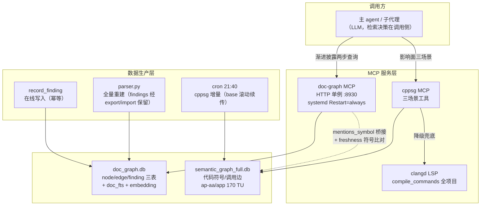
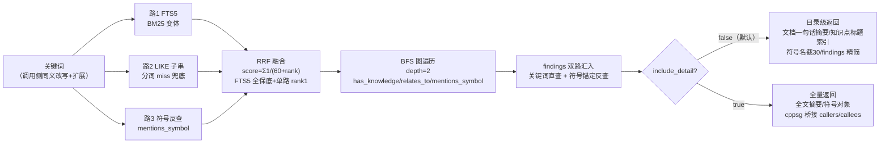
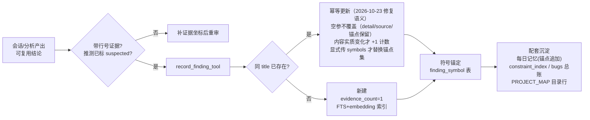
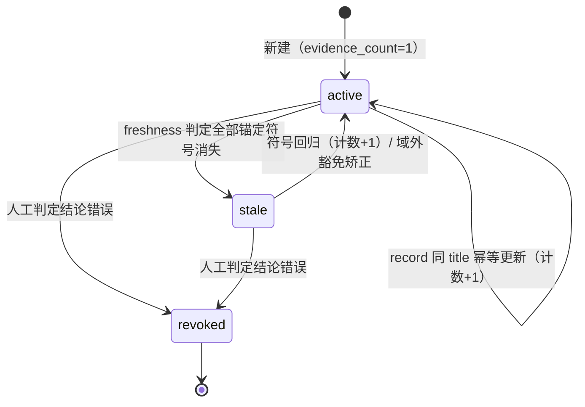

# 记忆图谱架构设计（doc-graph + cppsg）

> 版本：V1.0 ｜ 日期：2026-10-23 ｜ 状态：初稿
> 工程仓库：FS-Yuao/cpp-semantic-graph
> 定位：记忆图谱子系统的架构设计——组件、数据模型、检索管线、写入管线、生命周期、接口与运维。harness 全景见 [QBuddy_HARNESS_GUIDE.md](QBuddy_HARNESS_GUIDE.md)；优化决策依据见 [HARNESS_OPTIMIZATION_HLD.md](HARNESS_OPTIMIZATION_HLD.md)。

## 变更履历

| 版本 | 日期 | 修订内容 | 作者 |
|---|---|---|---|
| V1.0 | 2026-10-23 | 初版：从 HARNESS_OPTIMIZATION_HLD V1.x 的记忆子系统章节独立扩展成册，补架构图/检索管线图/生命周期状态图与接口表 | 主 agent |

## 1 引言

### 1.1 范围

覆盖"我们的图谱"三层含义：**doc-graph**（文档知识图谱，经验结论主库）、**cppsg**（C++ 代码语义图谱，影响面分析）、**clangd LSP**（全项目符号兜底）。不含 hook 注入路的纯文本记忆（PROJECT_MAP/RECENT 属 L2 注入路，见 QBuddy_HARNESS_GUIDE §3.2）。

### 1.2 术语

| 术语 | 定义 |
|---|---|
| document / knowledge 节点 | markdown 文档 → 文档节点；其 ## 章节 → 知识点节点（含行号定位） |
| finding | 经验结论条目：fact/constraint/decision/lesson/risk 五型，带符号锚定与证据计数 |
| mentions_symbol | 文档/结论到代码符号的桥接边 |
| freshness | finding 时效检测：锚定符号在代码库中是否仍存在 |
| 渐进披露 | 检索默认返回目录级，判断相关后再取全量的两步查询模式 |

## 2 总体架构



（图中无标题的分层为存储层：两库均为 SQLite——doc_graph.db 管文档与经验结论，semantic_graph_full.db 管代码符号；"存储层（SQLite）"原标题因 ELK 穿字取舍移入本段。）

组件职责：

| 组件 | 职责 | 关键设计 |
|---|---|---|
| doc-graph MCP | 文档/知识点/finding 检索与写入 | HTTP 单例（systemd user unit），改代码后 `systemctl --user restart doc-graph-mcp` 生效 |
| cppsg MCP | 代码符号查询/callers-callees/影响面三视角 | 只覆盖 ap-aa/app；SDK/BSW 符号查空时自动提示降级 clangd |
| clangd LSP | 全项目（含 SDK/BSW）符号定义/引用 | 降级链第二级，最后才是文本 grep |
| parser.py | docs 目录全量重建 node/edge/doc_fts | findings 三表独立管理，重建经 export/import 防丢失；重建后五项验收自检 |
| finding_store.py | finding 三表在线写入与检索 | 同 title 幂等合并、生命周期衰减排序、freshness 三层判定 |

## 3 数据模型

### 3.1 doc_graph.db（doc-graph）

| 表 | 内容 | 说明 |
|---|---|---|
| node | document（267）/ knowledge（1520）/ symbol（716） | document：frontmatter summary 优先、正文首段兜底；knowledge：章节首段摘要（`stop_at_heading` 章节边界，空摘要章节不建节点） |
| edge | has_knowledge / relates_to / mentions_symbol | manual（frontmatter 声明）与 auto（链接/反引号提取）两档置信 |
| doc_fts | FTS5（unicode61 + CJK 预分词） | title/summary/path/tags 四列 |
| finding | 五型结论：title/detail/symbols/status/confidence/evidence_count/last_confirmed | 符号锚定 100%（finding_symbol 反查表）；FTS + 可选向量 embedding |
| finding_fts | finding 全文索引 | 词法路主力 |

### 3.2 semantic_graph_full.db（cppsg）

代码符号节点（class/struct/function，含 parent_class/file_path）+ calls 边 + doc_section 关联边。**覆盖域=ap-aa/app 业务模块**（170 TU）——SDK/BSW/工具链符号不存在是常态而非"已删除"，freshness 判定据此设计域外豁免（§6.2）。

## 4 检索管线



设计要点：

- **排序维持已验证组合**：同义表扩展 + RRF 融合 + 生命周期衰减排序（evidence_count 加成、last_confirmed 180 天线性衰减）。cross-encoder 重排**不做**——bge-m3 重评 margin -0.048 三量级全败（finding:20261010-101208-bb90），且无"排错"实证；重评触发条件=排错实证 ≥3 例。
- **渐进披露**（2026-10-23 落地）：默认目录级，实测同关键词 79153B→10215B（13%）；`include_detail=true` 取全量。对标 Claude 生产系统渐进披露模式。
- **检索决策在调用侧**：服务端不做云 LLM 改写（MCP 调用方本身就是 LLM），同义表只覆盖高频口语对照。

## 5 写入管线



写入纪律：行号级证据坐标强制（日志=文件名+行号，代码=文件名+行号）；五型分类；触发靠回写五步协议与 reviewer 第四阶段核验，**非自动抽取**——"保证据质量、放弃覆盖率"的有意取舍。

## 6 finding 生命周期

### 6.1 状态机



### 6.2 freshness 三层判定（2026-10-22 定稿）

```
finding.symbols
  → 0) 域外豁免：命中 _OUT_OF_DOMAIN_RE（TLF35584/MucRst 等 MCU 日志/芯片
       标识，永不出现于代码库）→ 无法判定，不标 stale；历史误标恢复 active
  → 1) cppsg 精查：三级宽松匹配（精确/Class::Method 拆分/短名 LIKE）
  → 2) 仓库级 grep 兜底（仅当 cppsg 全查空）：检索根=adc4.0 工作区 +
       cpp_semantic_graph + ~/.codebuddy，全名→短名两探针
  → 全部消失才标 stale（原则：宁漏标不误标）
```

背景：cppsg 只覆盖 ap-aa/app，BSW（dm/DoIP 栈）、SDK、工具链脚本符号"不在 cppsg"≠"已删除"——原单层判定一次误标 14/118（12%），三层化后归零（commit 7a6ce36）。

### 6.3 衰减排序刹车

召回排序 = evidence_count 加成（封顶 10）+ last_confirmed 180 天线性衰减。纯检测（确认 active 不变）不刷新计数，防周期任务稀释"被证据支持"的语义。存量回填 2026-10-23 完成（119/119 非零）。

## 7 接口表（MCP 工具清单）

| 工具 | 参数 | 场景 | 备注 |
|---|---|---|---|
| doc_graph_search_tool / doc_search | keyword, scope, include_detail, depth, bridge_to_code | 全图检索（渐进披露两步） | scope=findings 直查经验结论 |
| search_findings_tool（deprecated→doc_search） | keyword/symbol/ftype/limit | "之前关于 X 的结论"直查 | |
| record_finding_tool | title/detail/ftype/symbols/tags/confidence | 沉淀结论（同 title 幂等） | 推测必须标 suspected |
| check_finding_freshness_tool（deprecated→doc_admin） | — | 时效检测（有状态，先 DB 副本预演） | |
| doc_admin | action=stats/list/freshness/**revoke** | 图谱统计/文档清单/时效/**撤销结论**（2026-10-23 新增，finding_id+reason） | revoke 使 active→revoked 真实可达，错误结论不再只能靠新结论对冲 |
| cpp_symbol_lookup / cpp_relationship / cpp_impact_analysis | 符号名 | 代码三场景（是什么/关系/影响面） | 原子工具已 deprecated |
| clangd get_definition / find_references 等 | 符号/位置 | SDK/BSW 兜底 | 降级链第二级 |

## 8 运维

| 事项 | 命令/机制 | 注意 |
|---|---|---|
| 全量重建 | `python3 parser.py <docs_root> --db doc_graph.db` | findings 经 export/import 自动保留；重建后核对五项验收 + findings 计数 |
| 服务重启 | `systemctl --user restart doc-graph-mcp` | 改 doc_graph 代码后必须；勿 pkill 按路径清理（会误杀 systemd 服务） |
| cppsg 增量 | cron 21:40（base 滚动续传） | 多天未跑会漏的场景已由 last_incremented_ref 覆盖 |
| 有状态操作纪律 | 任何写 DB 的操作先 `cp` 副本预演 | 2026-10-22 freshness 误标事故教训 |
| 遥测 | doc_graph_telemetry.jsonl / query_telemetry.jsonl | search-stats 消费，不依赖客户端会话日志 |

## 附录 A 数据基线（2026-10-23）

- doc_graph.db：2507 节点（document 271 / knowledge 1520 / symbol 716）/ 3527 边 / findings 120 条
- **符号锚定实测口径：111/120（92.5%）有锚点，9 条零锚点**（多为过程性结论无代码符号可锚）——此前文档宣称"100% 锚定"为检查口径错误（查 symbols 列非空，`'[]'` 空数组也计入），2026-10-23 评审纠正
- 重复摘要对 27（均为 archive 旧版 HLD 备份的真实内容重复）/ 空摘要 0
- 重建五项验收：解析成功率 ≥95% / 重复边=0 / P2 路径残留=0 / diary 符号区分 / 符号边去重——全过

## 附录 B 评审驱动的修复记录（2026-10-23 第二轮循环）

干净上下文审查子代理抓出 1 P0 + 12 P1 + 14 P2，当日止血 6 项：

| 编号 | 问题 | 修复 |
|---|---|---|
| P0-1 | 幂等更新不带 symbols 会静默清空历史锚点；"100% 锚定"宣称失实 | 空/None symbols 保留旧锚点；宣称改实测口径 |
| P1-2 | 更新整行覆盖致真实丢数据（BUG-025 detail 被空参抹空）；"v2 增量追加模式"不存在 | 空参不覆盖（detail/source/ftype/confidence/tags） |
| P1-1 | revoked 状态全接口不可达，错误结论只进不出（B110 互斥对实证） | doc_admin action=revoke 落地 |
| P1-4 | 主检索入口 findings 按 updated_at 升序排（最新在最后），衰减排序没覆盖 | 终排统一 (_lifecycle_boost, updated_at) 降序 |
| P1-3 | freshness"自净"实为手动工具（历史仅 2 次调用） | 挂入 21:40 cppsg 增量 cron 自动跑 |
| P1-8 | 词法零命中也付向量计算（含首次 20s 模型加载） | 惰性 embedding：仅词法有命中才算 |
| P2-4 | 重复/重试调用虚增 evidence_count | 内容实质变化才 +1 |

验证：DB 副本冒烟五项全过（空参更新锚点保留 2/detail 保留/重复调用计数不增/revoke 生效且默认召回排除/排序键单调递减）。

**已知未修（下轮候选）**：P1-5 include_symbols 参数缺失（已补 caps 缓解）、P1-6 检索质量反馈闭环（rerank 重评触发条件结构性死循环——需轻量 thumbs-down 遥测）、P1-7 写耗时双峰（中位 0.2s/3 离群点贡献 79%，O-4 需先 profile 三成分再动）、P1-9 重建与在线写无锁协调、P1-10 接口合并治理失败（新工具 0 使用）、P1-11 写入校验零强制、P1-12 title 碎片化（B110 一主题 8 条）、P2 全量（CJK 单字 OR/同义表 15 组/BFS N+1/遥测无轮转等）——完整清单见本附录评审报告原文。
