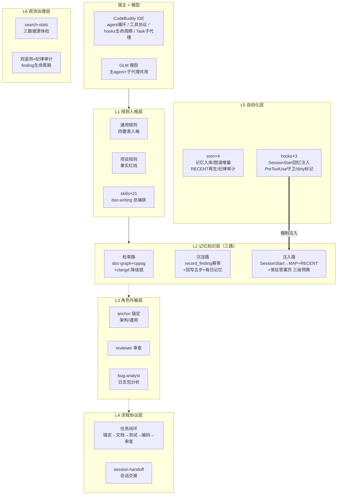

# QBuddy Harness 讲解——当前工作环境的完整构成

> 版本：V1.0 ｜ 日期：2026-10-23 ｜ 状态：初稿
> 定位：讲解文档。回答"我们的 harness 里都有什么、各自干什么"。
> 关联文档：优化专项与路线见 [HARNESS_OPTIMIZATION_HLD.md](HARNESS_OPTIMIZATION_HLD.md)；记忆图谱架构设计见 [MEMORY_GRAPH_ARCHITECTURE.md](MEMORY_GRAPH_ARCHITECTURE.md)。

## 1 harness 是什么

harness = 承载 AI 模型完成工程任务的完整工作环境：**宿主框架（QBuddy IDE）+ 模型（GLM）+ 规则人格 + 记忆知识 + 角色外脑 + 流程协议 + 自动化 + 观测治理**。宿主只提供机制，真正的"调教成果"是我们叠加的六层配置——模型每换一代，这六层原样继承。

主干（宿主→L1→L2）为实线强依赖，L3/L4 为虚线支撑链；L5 hook 对 L2 注入路的强制驱动是整个回忆机制的引擎（加粗实线）。三条细粒度关系不入图（ELK 细线穿层标题不可控，信息由本段承载）：L5 cron 对检索路做图谱增量维护；L2 沉淀路遥测留痕至 L6；L2 检索路被 L6 search-stats 体检统计。

## 2 宿主原生机制（QBuddy 提供的底座）

| 机制 | 是什么 | 我们怎么用 |
|---|---|---|
| agent 循环 | 模型↔工具调用↔结果回灌的主循环 | 一切工作的执行底座 |
| 工具协议 | 文件读写/命令执行/检索等内建工具 | 配合 rules 约束使用边界（grep 仅限非代码内容等） |
| hooks 生命周期 | 27+ 事件钩子（兼容 Claude Code 规范），SessionStart 的 stdout 注入上下文是官方例外通道 | 挂 3 个（见 §3.5），其中 SessionStart 承担强制回忆注入 |
| Task 子代理 | spawn 独立上下文的子代理（含团队模式/异步） | 四个角色外脑（§3.3）+ 并行只读消化模式 |
| MCP | 标准化的外部工具服务协议 | doc-graph（HTTP 单例 :8930）、cppsg、clangd 等图谱工具全走 MCP |
| automations | IDE 内置定时任务 | 实测调度引擎不稳定（半成品），仅留两条兜底不依赖 |
| 记忆目录 | 客户端内置记忆存储 | 未使用，记忆体系自建（§3.2） |

## 3 六层配置详解

### 3.1 L1 规则人格层——每次会话注入的"操作系统"

三段式加载：**通用规则**（四要素人格：职责分工/工具定义/范围红线/做事性格，含任务流程七步与编码决策阶梯）→ **项目规则**（ADC4.0 特有事实清单与项目红线：GetSocBootChain 禁 SetError、板端零写原则等条件-动作式约束）→ **按需层**（memory 文件与 doc-graph，任务入口按主题召回）。另有 21 个 skills（doc-writing 写文档总编排、board-log-analysis 日志包分析 SOP、search-stats 体检等），按 name+description 常驻、正文按需展开。

### 3.2 L2 记忆知识层——三路记忆体系

- **注入路**：SessionStart hook 每次会话开头强制注入三级内容——PROJECT_MAP（长期知识地图目录，12KB 上限）、RECENT（14 天工作窗口，8KB）、常驻答案页（高频架构事实预计算答案，3KB 白名单）。设计依据：连续会话必有上下文关联，回忆必须机制化而非依赖自觉。
- **检索路**：doc-graph MCP（文档知识图谱：文档节点/知识点/finding 经验库，FTS5 词法+向量降级+同义表，渐进披露两步查询）+ cppsg（C++ 代码语义图谱，lookup/relationship/impact 三场景工具）+ clangd LSP（全项目含 SDK/BSW 兜底）。降级链：cppsg 查代码符号 → clangd → 最后才是文本 grep。
- **沉淀路**：会话产出可复用结论时 record_finding 幂等写入（五型分类+符号锚定+行号级证据坐标，推测强制标 suspected）；收尾走回写五步（架构文档同步/HTML 同步/doc-graph 重建/cppsg 增量/约束索引增补）；每日记忆文件按锚点追加协议维护。

### 3.3 L3 角色外脑层——判断类工作外包给干净上下文

- **architect-anchor**（项目内锚定）/ **anchor-general**（项目外锚定）：任务入口从知识库检索约束与历史决策，产出锚定工件，只读不实施；
- **reviewer**：改动完成后的四阶段协议审查+知识库回写核验；
- **bug-analyst**：日志包分析官，按 board-log-analysis SOP 出证据化报告并沉淀 finding；
- **并行只读消化**：≥3 文档或多模块信息收集时并行 spawn 只读 digest 子代理，主上下文只汇总。

### 3.4 L4 流程协议层

任务七步（入口锚定→文档先行→测试方案先行→编码→系统级验证+审查）；**session-handoff**（长任务会话交接：save 蒸馏状态 / restore 带代际前缀复述确认）；dev-loop 开发闭环编排。防退化机制内建：连续结论零证据编号或被质疑秒反驳 = 退化信号，触发交接（本会话 10-23 实测触发过一次 gate，自检通过解锁）。

### 3.5 L5 自动化层

- **cron×4**：21:35 记忆入库（ingest-memory）、21:40 cppsg 图谱增量（base 滚动续传防漏）、21:45 RECENT 再生、21:50 纪律审计（含仓库未提交检查）；
- **hooks×3**：SessionStart 回忆注入 + AI 周报提醒检测；PreToolUse Task 模式守卫（spawn 必须 bypassPermissions，防审批挂起）；PostToolUse dirty 标记。

### 3.6 L6 观测治理层

search-stats 三数据源体检（会话日志/服务端遥测/图谱 DB 静态指标）、doc-graph 与 cppsg 双遥测 jsonl、纪律审计每日输出、finding 生命周期治理（evidence_count 证据计数+衰减排序+freshness 时效检测）、迁移资产四层模型冷备（GitHub FS-Yuao/adc4-knowledge-docs）。

## 4 机制坑台账（宿主原生限制，已有补丁或绕行）

| 坑 | 现象 | 处置 |
|---|---|---|
| Task spawn 审批挂起 | spawn 子代理不带 mode 参数时审批弹窗无人应答即 abort（10003） | PreToolUse hook 强制拦截非 bypassPermissions 的 Task 调用（机制级补丁） |
| UserPromptSubmit stdout 不注入 | 该 hook 的输出不进入模型上下文（09-23 实证） | 改用 SessionStart 通道承载注入 |
| IDE automations 调度不稳 | 任务 fire 后被 orchestrator 重启打断，到期不拉起 | 不作依赖，cron 为主路 |
| 会话日志停写 | 客户端 09-08 起不再落盘会话转录 | 观测体系切服务端遥测，不依赖客户端 |

## 5 延伸阅读

- 优化了什么、对标结论、分级路线：[HARNESS_OPTIMIZATION_HLD.md](HARNESS_OPTIMIZATION_HLD.md)
- 记忆图谱的架构设计（数据模型/检索管线/生命周期）：[MEMORY_GRAPH_ARCHITECTURE.md](MEMORY_GRAPH_ARCHITECTURE.md)
